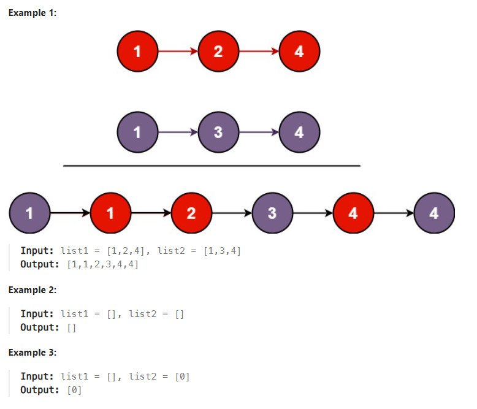

# Title
Merge Two Sorted Lists https://leetcode.com/problems/merge-two-sorted-lists/description/

## Desc
You are given the heads of two sorted linked lists list1 and list2.

Merge the two lists into one sorted list. The list should be made by splicing together the nodes of the first two lists.

Return the head of the merged linked list.

## Solution
Алгоритм (два указателя):

1. Создать фиктивный узел `dummy` и указатель `current = dummy`.
2. Пока оба списка не пусты:
   - Сравнить значения `list1.val` и `list2.val`.
   - Присоединить к `current.next` узел с меньшим значением.
   - Передвинуть указатель выбранного списка.
   - Передвинуть `current` на добавленный узел.
3. Присоединить оставшуюся часть непустого списка: `current.next = list1 ?? list2`.
4. Вернуть `dummy.next` — голову объединённого списка.

## Rating
- Время: `O(n + m)`.
- Память: `O(1)` — существующие узлы переиспользуются.