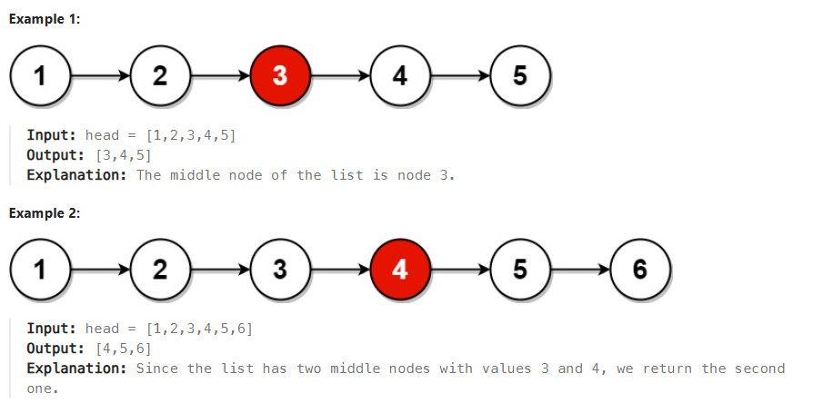

# Title
Middle of the Linked List https://leetcode.com/problems/middle-of-the-linked-list/description/

## Desc
Given the head of a singly linked list, return the middle node of the linked list.
If there are two middle nodes, return the second middle node.
 

## Solution
Быстрый(fast) и медленный(slow) указатель
Fast указатель двигаем на 2.
Slow двигаем на 1.
Цикл пока fast не достигнет конца списка.
Если достигнет slow будет указывать на середину списка.

## Rating
По времени O(n)
По памяти O(1)