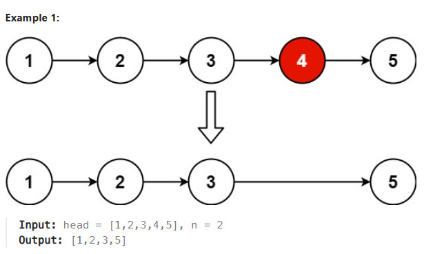

# Title
Remove Nth Node From End of List https://leetcode.com/problems/remove-nth-node-from-end-of-list/description/

## Desc
Given the head of a linked list, remove the nth node from the end of the list and return its head.

Example 1:

Example 2:

Input: head = [1], n = 1
Output: []
Example 3:

Input: head = [1,2], n = 1
Output: [1]
 

Constraints:

The number of nodes in the list is sz.
1 <= sz <= 30
0 <= Node.val <= 100
1 <= n <= sz

## Solution
Надо удалить n-элемент с конца. 
Создаётся первый пустой (dummy node) элемент, чтобы удаление первой ноды произошло. 
1. Нужно подсчитать длину списка с dummy node - len
2. Нужно проитерироваться на len - n - 1
3. Удаляем ноду
4. Возвращаем ответ dummy.next.

## Rating
По времени O(n)
По памяти O(n)