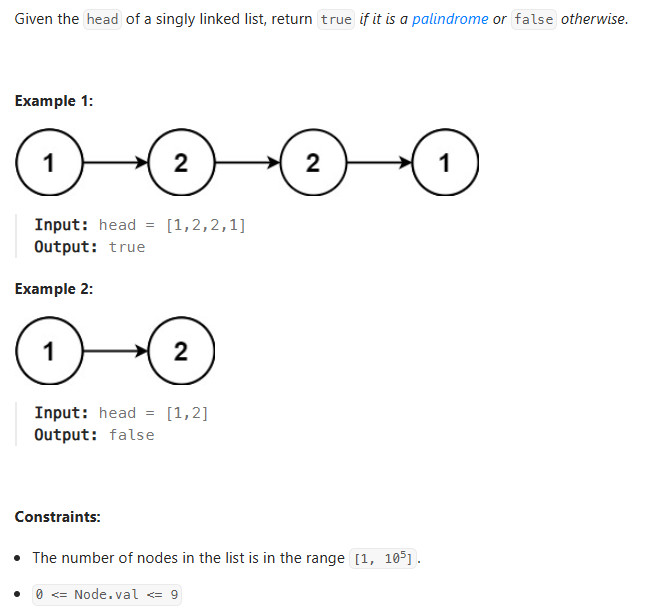
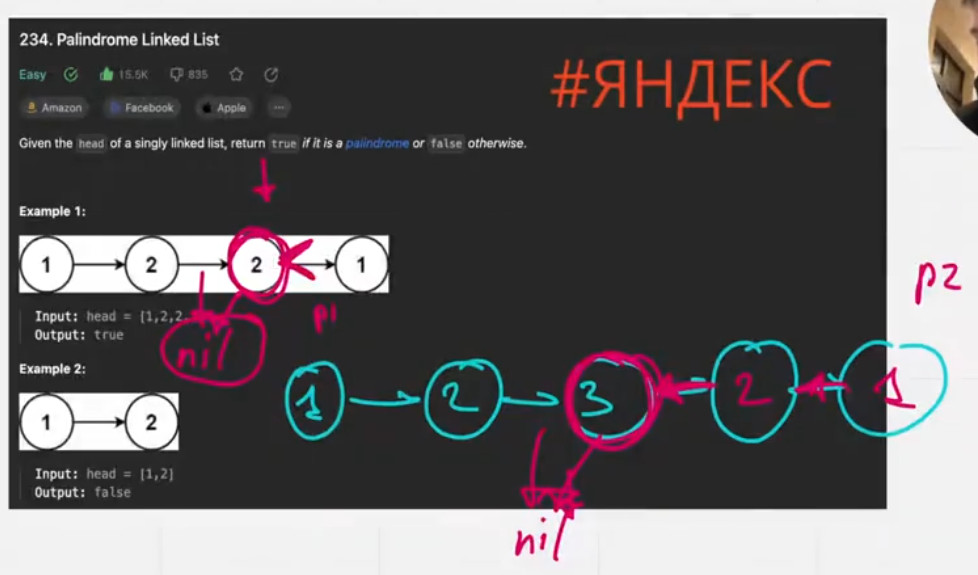

# Title
Palindrome Linked List https://leetcode.com/problems/palindrome-linked-list/description/

## Desc

## Solution
1. Найти middle node
2. Для найденной вершины сделать реверс начиная с middle
3. Пройти и сравнить 2 списка.

## Rating
По времени O(n)
По памяти O(1)