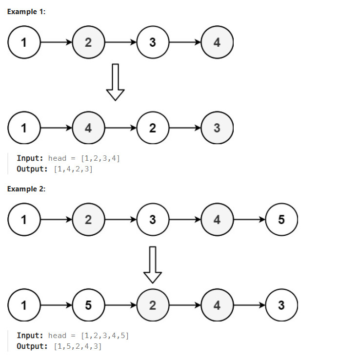

# Title
Reorder List https://leetcode.com/problems/reorder-list/description/

## Desc
You are given the head of a singly linked-list. The list can be represented as:

L0 → L1 → … → Ln - 1 → Ln
Reorder the list to be on the following form:

L0 → Ln → L1 → Ln - 1 → L2 → Ln - 2 → …
You may not modify the values in the list's nodes. Only nodes themselves may be changed.

## Solution
1. Разделить список на две части: первую половину и вторую половину.
2. Найти узел, стоящий **перед серединой**, — он станет концом первой части.
3. Отсоединить вторую половину от первой.
4. Развернуть вторую половину в обратном порядке.
5. Поочерёдно соединить узлы: один из первой части, затем один из развёрнутой второй части.
6. Продолжать чередование, пока вторая часть не закончится.
7. В результате исходный порядок `1, 2, 3, 4, 5` станет `1, 5, 2, 4, 3`.

Суть: **берём узлы с обоих концов списка и ставим их попарно внутрь**, не используя дополнительный массив.

## Rating
O(n) по времени и O(1) по памяти