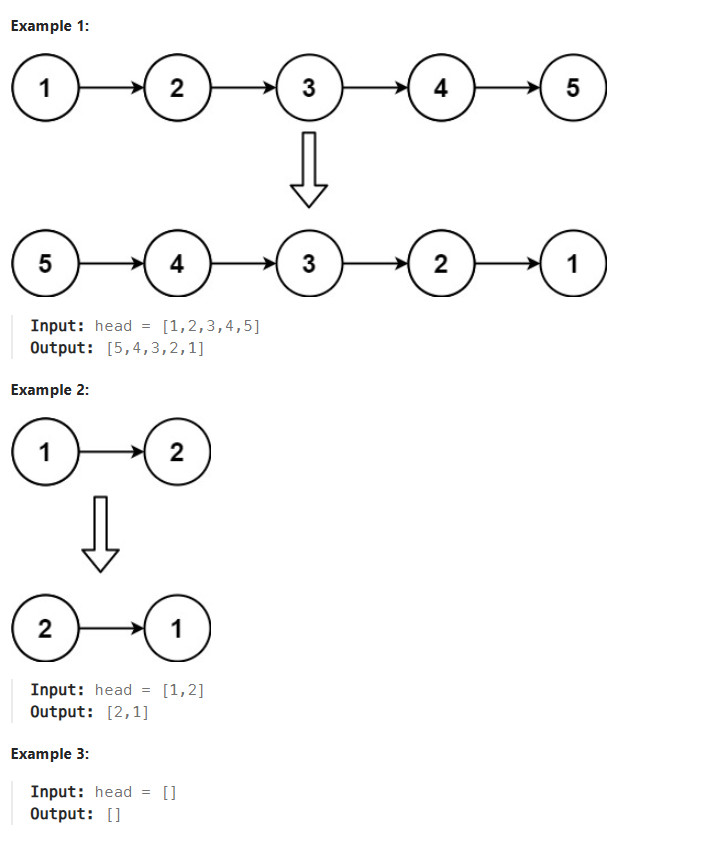
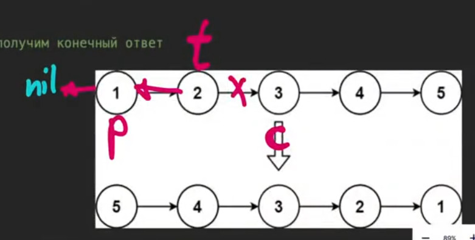

# Title
Reverse Linked List https://leetcode.com/problems/reverse-linked-list/description/

## Desc
Given the head of a singly linked list, reverse the list, and return the reversed list.
 

## Solution
2 указателя 
1. на каждом шаге curr двигаем по листу на 1 ноду вперёд
2. prev поддерживает массив в котором будет ответ

Исходно
1 -> 2 -> 3 -> 4 -> 5 -> None

Через несколько шагов
None <- 1 <- 2   	3 -> 4 -> 5 -> None
						prev  curr

в prev получаем конечный ответ

заводим временную переменную на текущий узел
 

## Rating
По времени O(n) - зависит от количества вершин
По памяти O(1) - работаем над текущим списком